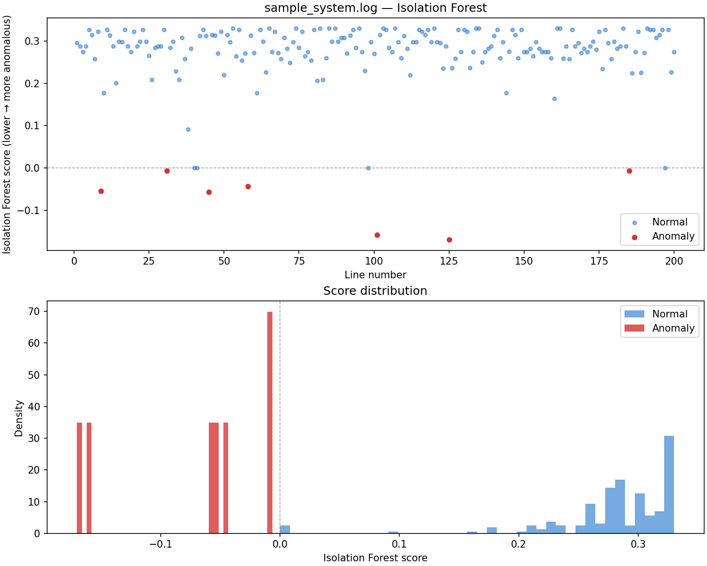

# 🔍 ML-Based System Log Analyzer


A command-line tool that finds **unusual lines in system logs** using **Isolation Forest**, an unsupervised machine-learning algorithm.

You don't need labelled data or hand-written rules for every error type. The tool turns each log line into numeric features, learns what "normal" looks like, and flags the lines that don't fit, ranked from most to least suspicious.



---

## ✨ Features

- **Unsupervised detection:** no labelled training data required
- **8 features per line:** length, word count, ratios of digits / uppercase / spaces / punctuation / unique characters, and a count of severity keywords (`error`, `panic`, `timeout`, `oom`, …)
- **Ranked output:** flagged lines sorted by anomaly score, most suspicious first
- **CSV export** of every line with its score and anomaly flag
- **Visual report:** a PNG with a score-per-line scatter plot and a score distribution histogram
- **Built-in synthetic log generator,** so you can try it without real logs
- Reproducible results via a fixed random seed

---

## 🧠 How it works

```
log file ──▶ one row per line ──▶ 8 numeric features ──▶ StandardScaler
                                                              │
                                                              ▼
              ranked anomalies ◀── score each line ◀── Isolation Forest (200 trees)
```

**Isolation Forest** builds many random decision trees that split the data at random points. Unusual lines are easy to separate from the rest, so they get isolated in only a few splits. Normal lines sit in a crowd and need many splits. The fewer splits a line needs on average, the lower (more anomalous) its score.

The `--contamination` setting tells the model roughly what fraction of lines you expect to be anomalous, which sets the cut-off for flagging.

---

## 📊 Results on the included sample

`sample_system.log` has 200 lines, with 11 anomalies injected among normal service logs (kernel panics, segfaults, OOM kills, gateway timeouts, disk warnings and junk lines).

| `--contamination` | Lines flagged | Real anomalies caught | False alarms |
|---|---|---|---|
| 0.05 (default) | 7 | 7 of 11 | 0 |
| **0.06** | **12** | **11 of 11** | **1** |
| 0.08 | 16 | 11 of 11 | 5 |

Setting contamination close to the real anomaly rate catches every injected anomaly with a single false alarm. Setting it too high starts flagging ordinary lines.

---

## 🛠 Setup

```bash
git clone https://github.com/AdepuPranav/ML-based-system-log-analyzer-using-Isolation-Forest-for-anomaly-detection.git
cd ML-based-system-log-analyzer-using-Isolation-Forest-for-anomaly-detection
pip install -r requirements.txt
```

---

## 🚀 Usage

**Analyze the included sample and save a plot:**
```bash
python analyzer.py sample_system.log --contamination 0.06 --plot
```

**Quick demo with built-in lines (no file needed):**
```bash
python analyzer.py --demo
```

**Generate your own synthetic log, then analyze it:**
```bash
python analyzer.py --write-sample my.log --sample-lines 1000 --sample-anomaly-rate 0.05
python analyzer.py my.log --output results.csv --plot report.png
```

### Example output
```
Lines: 200  Flagged anomalies: 7
Features used: ['length', 'digit_ratio', 'upper_ratio', 'space_ratio', 'punct_ratio', 'unique_char_ratio', 'word_count', 'severity_hits']

Top anomalies (lowest score = most anomalous):
  L125 score=-0.1701  FAIL FAIL FAIL FAIL FAIL FAIL FAIL FAIL ...
  L101 score=-0.1588  AAAAAAAAAAAAAAAAAAAAAAAAAAAAAAAAAAAAAAAA ...
  L45 score=-0.0574  segfault at 7f8b2c001000 ip 000055aabbccddee ...
  L9 score=-0.0542  OOM killer invoked: process java(pid=88421) ...
  L58 score=-0.0434  KERNEL PANIC: NULL pointer dereference ...
```

### Options

| Flag | Default | Description |
|---|---|---|
| `logfile` | – | Path to a UTF-8 text log |
| `--demo` | off | Use built-in synthetic lines instead of a file |
| `--contamination` | `0.05` | Expected fraction of anomalous lines |
| `--max-lines` | all | Only read the first N lines |
| `--random-state` | `42` | Seed for reproducible results |
| `--output` | – | Write a CSV: `line_no, anomaly, score, preview` |
| `--plot [PATH]` | – | Save the visual report (default `anomaly_showcase.png`) |
| `--write-sample PATH` | – | Generate a synthetic log file and exit |
| `--sample-lines` | `800` | Lines to generate with `--write-sample` |
| `--sample-anomaly-rate` | `0.06` | Fraction of anomalous lines to inject |
| `--sample-seed` | `42` | Seed for the generator |

---

## 📁 Project structure

```
├── analyzer.py          # Feature extraction, Isolation Forest, CLI, plotting
├── synthetic_logs.py    # Synthetic log generator for demos and testing
├── sample_system.log    # 200-line sample with injected anomalies
├── anomaly_showcase.png # Example visual report
└── requirements.txt
```

---

## ⚠ Limitations

- Features describe the **shape** of each line (length, character mix, keywords), not its meaning, so a dangerous line that looks like a normal one can slip through
- Each line is scored on its own. Patterns across time, such as a sudden burst of requests from one IP, are not detected yet
- The right `--contamination` value depends on your logs and needs some tuning

## 🔮 Possible improvements

- Parse structured fields (timestamp, service, status code, IP) and add time-window features like requests per minute or error rate per service
- Group repeated message templates (for example with the Drain algorithm) before scoring
- Compare against other detectors such as Local Outlier Factor or One-Class SVM
